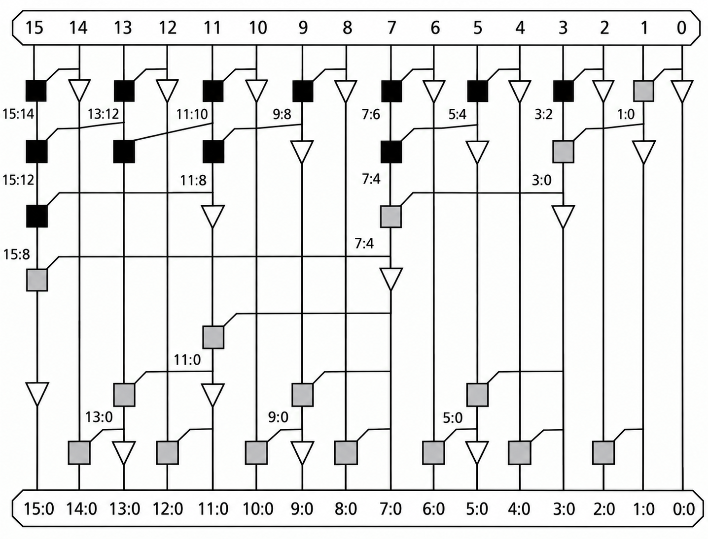
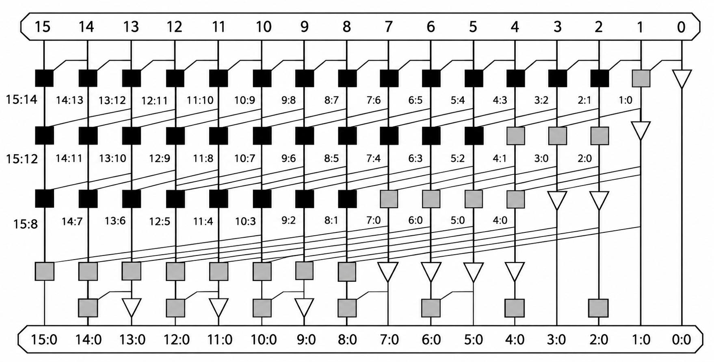
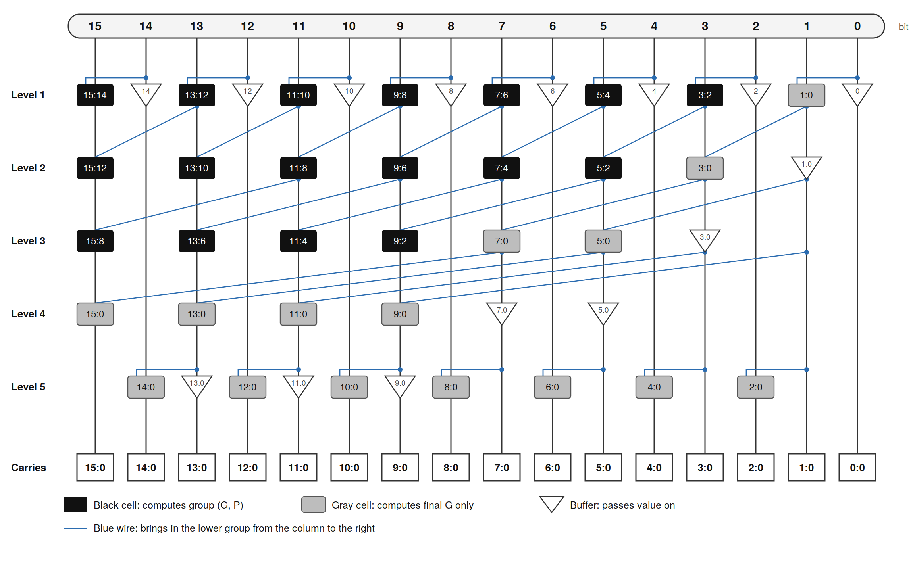

# 16-Bit Parallel Prefix Adders in Verilog

Implementation and functional verification of three 16-bit parallel-prefix adders in Verilog HDL:

- Brent–Kung Adder
- Kogge–Stone Adder
- Han–Carlson Adder

This project explores three parallel-prefix adder architectures with different trade-offs in logic depth, wiring complexity, and hardware area.

## Repository Structure

```
.
├── src/
│   ├── brentkung.v
│   ├── koggestone.v
│   └── hancarlson.v
├── tb/
│   └── tb_adder.v
├── images/
│   ├── brentkung.png
│   ├── koggestone.png
│   └── hancarlson.png
└── README.md
```

## Adder Architectures

### 1. Brent–Kung Adder

The Brent–Kung architecture uses a sparse prefix tree to calculate carries efficiently, reducing prefix operations and wiring compared with a full Kogge–Stone network.

<p align="center">
  
</p>

### 2. Kogge–Stone Adder

The Kogge–Stone architecture uses a dense parallel-prefix network to achieve low logical carry depth. Its trade-offs include increased wiring complexity and potentially greater hardware area.

<p align="center">
  
</p>

### 3. Han–Carlson Adder

The Han–Carlson architecture combines features of the Kogge–Stone and Brent–Kung structures to balance logic depth, wiring complexity, and prefix-cell count.

<p align="center">
  
</p>

## Tools Required

- [Icarus Verilog](https://github.com/steveicarus/iverilog) – Verilog compilation and simulation
- [GTKWave](https://gtkwave.sourceforge.net/) – Waveform visualization
- Git – version control

## Simulation and Verification

The self-checking testbench instantiates all three adders and compares their outputs against a reference 17-bit addition.

The testbench includes:

- Directed test cases covering zero, maximum operands, and carry propagation
- 100,000 randomized operand pairs
- Checks of both the 16-bit sum and the unsigned carry-out for every adder

### Compile

Run the following command from the repository root:

```
iverilog -g2001 -Wall -s tb_adder -o sim \
    tb/tb_adder.v \
    src/brentkung.v \
    src/koggestone.v \
    src/hancarlson.v
```

### Run the Simulation

```
vvp sim
```

A successful run reports zero failures and finishes with output similar to:

```
Total input pairs : 100019
Total failures    : 0
RESULT: ALL ADDERS PASSED
```

The exact output depends on the testbench implementation. A zero-failure result means all three adders matched the reference for every tested input pair.

## Project Goals

- Implement three parallel-prefix adder architectures in synthesizable Verilog
- Understand their structural differences
- Verify arithmetic correctness using a self-checking testbench
- Establish a foundation for synthesis, timing, and area comparisons

## Future Improvements

- Compare synthesis area and critical-path delay
- Generate and inspect simulation waveforms using GTKWave
- Perform exhaustive or formal equivalence checking
- Compare the architectures under identical synthesis constraints
